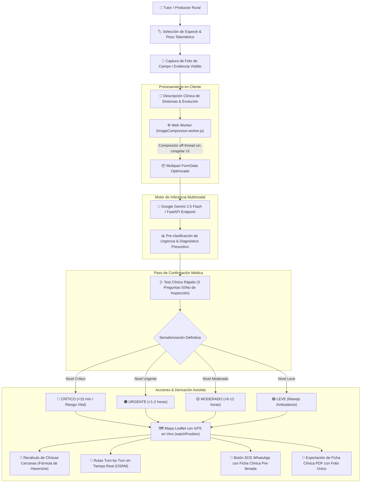

# VetIA - Sistema de Triaje y Urgencias Veterinarias Asistidas por IA

Plataforma inteligente de triaje clínico veterinario, telemetría y derivación médica de urgencias orientada al sector pecuario, zootécnico y rural (con soporte especializado para el departamento de Nariño y Altiplano de Pasto).

---

## 🐄 Tabla de Especies Zootécnicas y Rurales Soportadas

VetIA incorpora un motor de telemetría de peso y evaluación de urgencias calibrado para 8 categorías de animales de producción y compañía en el campo:

| Especie | Icono | Categoría Pecuaria | Peso Referencial | Rango Fisiológico | Motivos de Consulta y Síntomas Frecuentes |
| :--- | :---: | :--- | :---: | :---: | :--- |
| **Bovino** | 🐄 | Rumiante Mayor | ~450 kg | 40 - 1200 kg | Timpanismo ruminal, gabarro/pododermatitis, diarreas neonatales, distocias, mastitis aguda. |
| **Equino** | 🐎 | Monogástrico Mayor | ~380 kg | 80 - 750 kg | Síndrome de abdomen agudo (cólico equino), heridas por alambre de púa, laminitis, disnea. |
| **Porcino** | 🐖 | Monogástrico de Granja | ~95 kg | 1 - 350 kg | Síndromes respiratorios porcinos, eritemas violáceos en orejas, diarrea en lechones, postración. |
| **Ovino / Caprino** | 🐑 | Rumiante Menor | ~45 kg | 4 - 130 kg | Miasis/gusaneras en lana, anemia marcada (*Haemonchus contortus* / FAMACHA), cojera interdigital. |
| **Aves de Corral** | 🐔 | Avícola de Campo | ~2.4 kg | 0.05 - 8.0 kg | Moquillo aviar, estertores respiratorios, decaimiento agudo, crestas cianóticas, diarrea blanca. |
| **Cuyes / Conejos** | 🐹 | Cunicular / Granja | ~1.2 kg | 0.15 - 6.0 kg | Timpanismo cecal por forraje húmedo, tortícolis/ataxia, sarna en orejas, neumonía bacteriana. |
| **Canino** | 🐕 | Canino Rural | ~22 kg | 1 - 90 kg | Mordeduras de serpientes, heridas de faena, intoxicaciones con agroquímicos, gastroenteritis. |
| **Felino** | 🐈 | Felino Rural | ~4.2 kg | 0.5 - 15 kg | Abscesos por peleas territoriales, retención urinaria, intoxicaciones, heridas infectadas. |

---

## 🔄 Diagrama de Flujo del Triaje Multimodal y Offline-First

El flujo de atención clínica integra compresión en hilos dedicados mediante Web Workers, inferencia multimodal de alta precisión y derivación satelital en tiempo real:



---

## 🚀 Guía de Ejecución y Pruebas en Localhost

### 1. Requisitos Previos
- **Node.js**: Versión 18.x o superior.
- **npm**: Versión 9.x o superior.
- Conexión a internet (para sincronización con Supabase y mapas OpenStreetMap).

### 2. Clonación y Configuración del Entorno
```bash
# 1. Clonar el repositorio
git clone https://github.com/cristiancg11/Proyecto_2_Veterinaria.git
cd Proyecto_2_Veterinaria/frontend

# 2. Configurar variables de entorno
cp .env.example .env
```

Asegúrate de que `frontend/.env` contenga tus credenciales:
```env
VITE_SUPABASE_URL=https://tu-proyecto.supabase.co
VITE_SUPABASE_ANON_KEY=tu-anon-key
VITE_API_URL=http://localhost:8000/api/v1/triage/analyze
```

### 3. Instalación de Dependencias
```bash
npm install
```

### 4. Ejecución en Modo Desarrollo
```bash
npm run dev
```
La aplicación quedará disponible en: `http://localhost:5173/`

### 5. Compilación de Producción
```bash
npm run build
npm run preview
```

---

## 🧪 Casos de Prueba Recomendados

1. **Flujo de Registro y Autenticación**:
   - Registrar una nueva cuenta ingresando un número de celular colombiano válido de 10 dígitos (iniciando por 3).
   - Validar que el celular quede asociado al perfil del tutor en Supabase.

2. **Evaluación de Triaje con Especie Rural**:
   - Seleccionar `Bovino` o `Equino`.
   - Comprobar que el peso referencial se ajuste automáticamente.
   - Presionar un síntoma frecuente sugerido para agregarlo al campo de descripción.
   - Adjuntar una imagen de prueba y enviar la evaluación.

3. **Geolocalización Satelital en el Mapa**:
   - Al desplegarse el mapa tras el test de confirmación, pulsar el botón *"Activar mi GPS en vivo"*.
   - Comprobar que el radar azul pulse en pantalla y calcule las distancias en km a las clínicas veterinarias de la zona.
   - Probar el botón de *"Avisar por WhatsApp"* para comprobar la estructura del mensaje SOS pre-formateado.

4. **Descarga de Ficha en PDF**:
   - Hacer clic en *"Descargar Ficha en PDF"*.
   - Verificar la presencia del encabezado esmeralda, el código de folio único `VET-NAR-YYYYMMDD-...` y los metadatos internos del documento.
